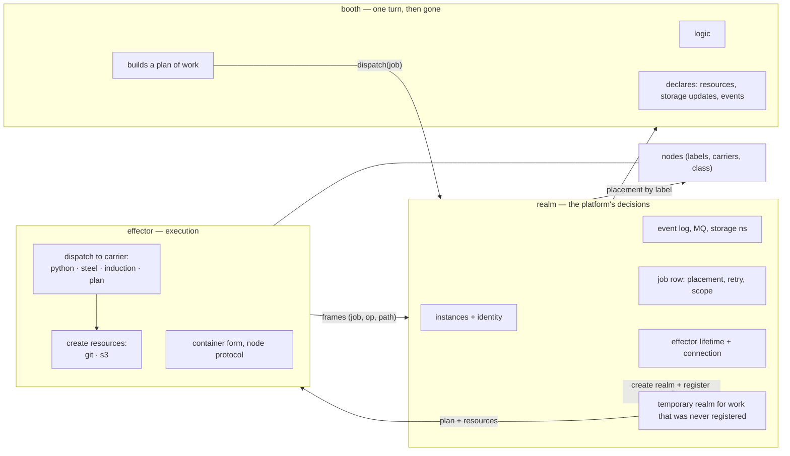

# The shape of the platform

> **Languages:** [English](DESIGN.md) (primary) · [中文](DESIGN.zh-CN.md)

Three layers, and the boundary between them is a single question: **who is allowed to decide this?** The
records that settle each boundary are listed at the end; this page is the map, not the law.

## What each layer owns

| layer | owns | does not own |
|---|---|---|
| **booth** | its logic; what resources it needs; which storage updates it performs; the events it triggers; the plan of work it hands over | execution (how a step runs, where, in which carrier), node lifetime, transport, encoding |
| **realm** | instances and their identity; the event log and routing; storage namespaces; the lifetime and connection of effectors; placement; job rows and their retry | business logic; which language a step runs in; resource credentials' semantics |
| **effector** | execution as such: dispatching to the right carrier (python / steel / induction / plan), creating resources (git / s3), the container form, the node protocol | what the work means; who may ask for it; how long a deployment should keep a node |

The asymmetry is deliberate: a booth states facts about the work, the realm makes platform decisions
about it, and the effector carries them out without knowing what they were for.

## One dispatch, end to end

Read the arrows as authority, not as calls: the booth may only *ask*; the realm is the only layer that
may decide where and for how long; the effector is the only layer that may touch the machine.

## The three things that are not allowed to leak

1. **A booth may not name a node, a carrier or a codec.** It says what the work is; placement, execution
   and encoding are answers the platform gives.
2. **A realm may not interpret work.** It moves jobs, grants resources and routes frames; it never reads
   a step's arguments to decide anything.
3. **An effector may not keep a policy.** It runs what it is given, refuses what it cannot carry (by
   name), and states its own shape at registration. Lifetime policy lives in its configuration, which is
   the deployment's word — not the node's opinion.

## Why not fewer layers

Every pair can be merged and each merge buys one thing and loses another:

- **booth + realm** makes the business logic decide placement, which is how a framework is born: change
  the logic, recompile the platform.
- **realm + effector** makes the platform learn carriers and containers, which is how a deployment
  question becomes a code change.
- **effector + node protocol inside the realm** is what the code did before ADR-0004: an embedded mode
  that bypassed the node protocol, so local and remote execution drifted apart until every fix had to be
  made twice.

## Records on this page

- effector ADR-0002 (a booth is a body), 0003 (the environment model: token, container, lease),
  0004 (the carrier is an interface), 0005 (a job is an envelope), 0006 (transport and connection lifetime)
- aura ADR-0050 (a realm is a row), 0051 (dispatch creates the realm), 0026 (a booth's storage is
  type-scoped), 0028 (the outer axis is a realm)
- gravity ADR-0011 (composition is a graph), 0013 (encoding is a transport axis)