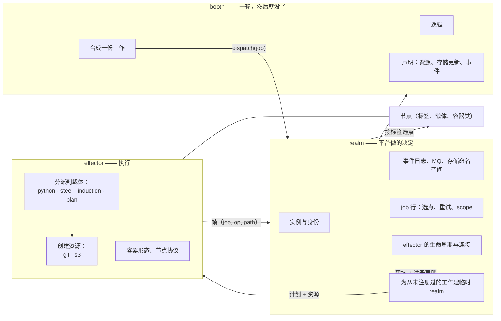

# 平台形状

> **语言：** [English](DESIGN.md)（主） · [中文](DESIGN.zh-CN.md)

三层，而层与层之间只回答一个问题：**这件事谁有权决定？** 裁决每一条边界的记录列在最后；这一页是地图，不是法律。

## 各层拥有什么

| 层 | 拥有 | 不拥有 |
|---|---|---|
| **booth** | 它的逻辑；需要哪些资源；做哪些存储更新；触发哪些事件；交给平台的那份工作 | 执行（某一步怎么跑、在哪跑、用哪个载体）、节点生命周期、传输、编码 |
| **realm** | 实例与身份；事件日志与路由；存储命名空间；effector 的生命周期与连接；选点；job 行与重试 | 业务逻辑；某一步用什么语言；资源凭据的语义 |
| **effector** | 执行本身：分派到正确的载体（python / steel / induction / plan）、创建资源（git / s3）、容器形态、节点协议 | 工作的含义；谁可以要求它；一个部署该把节点留多久 |

这种不对称是刻意的：摊位陈述关于工作的事实，realm 对它做平台层面的决定，effector 执行这些决定而不知道它们是为什么。

## 一次派单，从头到尾

把箭头读成权限，不是调用：摊位只能**请求**；realm 是唯一可以决定"在哪、多久"的层；effector 是唯一可以碰机器的层。

## 三条不许泄漏的东西

1. **摊位不得指名节点、载体或编码。** 它只说工作是什么；选点、执行与编码是平台给出的答案。
2. **realm 不得解释工作。** 它搬运 job、授予资源、路由帧；它从不读取某一步的参数来决定任何事。
3. **effector 不得持有策略。** 它执行被告知的东西，按名字拒绝它载不动的，注册时陈述自己的形状。生命周期策略在它的配置里，那是部署的话，不是节点的意见。

## 为什么不少一层

每一对都能合并，而每次合并买到一件事、丢掉另一件：

- **booth + realm** 让业务逻辑决定选点 —— 框架就是这样诞生的：改逻辑就要重编译平台。
- **realm + effector** 让平台学会载体与容器 —— 部署问题就变成了代码改动。
- **把节点协议塞回 realm** 正是 ADR-0004 之前的代码：嵌入模式绕过节点协议，于是本地与远程越来越不像，每个修复都要做两遍。

## 本页涉及的记录

- effector ADR-0002（摊位是一个 body）、0003（环境模型：token、容器、租约）、0004（载体是接口）、0005（job 是信封）、0006（传输与连接生命周期）
- aura ADR-0050（realm 是一行记录）、0051（派单即建域）、0026（摊位存储按类型划分）、0028（外层轴是 realm）
- gravity ADR-0011（组合是图）、0013（编码是传输轴）