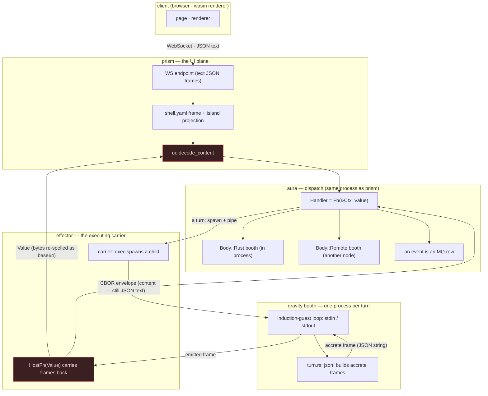

# 0004 — The carrier is an interface: pipes, sockets and a resident booth

> **Languages:** [English](0004-the-carrier-is-an-interface.md) (primary) · [中文](0004-the-carrier-is-an-interface.zh-CN.md)

**Status:** Proposed (2026-11-19). Nothing in this record is implemented; it is the shape the execution model should take before more is built on the current one.
**Date:** 2026-11-19

## Context

A booth is identified by `Body`: `Rust` (a handler compiled into the host), `Remote` (the same, on another node), `Script` (a guest process). `Script` is executed by effector's carrier, which today means exactly one thing: spawn a child process and talk to it over its stdin and stdout, framed by induction.

That single choice has been load-bearing in ways nobody wrote down. The guest learns when to stop because its parent closes stdin — so the process lifetime IS the pipe lifetime. A booth therefore cannot outlive a turn, cannot serve two users, and cannot be started any other way. Every deployment question ("how do I run gravity for everyone?") reduces to "change the carrier", and the carrier has no seam to change at.

Two costs are now concrete rather than hypothetical. First, **the model has no place for a resident booth**: gravity serving every user of an installation would need one process multiplexing turns, which the current lifetime rule forbids outright. Second, **the payload type is a `serde_json::Value` at every hop** (`HostFn`, `Realm::emit`, `aura_booth::Handler`), so a CBOR byte string cannot cross and has to be re-spelled as base64 — measured at 4568 B of CBOR becoming 6168 B at that seam, which is no better than compact JSON (6182 B).

## The shape as it stands

Three properties of that picture are the ones this record is about, and none of them is a bug in any single crate:

1. **Lifetime is an accident of the pipe.** EOF-on-stdin is what ends a guest, so "one process per turn" is not a policy, it is the only possible behaviour.
2. **The carrier is a hard-coded decision, not an interface.** `exec` is the only implementation, so every deployment shape has to be expressed as "spawn a child".
3. **The payload type erases to `Value` at the realm seam.** Binary dies there, and so does every type the producer knew.

## Decision (proposed)

**RULING — the carrier becomes an interface with four implementations, and lifetime belongs to the carrier rather than to the pipe.**

1. **One trait, four carriers.** `in-process` (handler), `pipe` (a child, today's `exec`), `unix socket`, `tcp` (later QUIC). The booth supplies frames; the carrier supplies transport, and nothing above it knows which one is in use.

2. **Lifetime is the carrier's rule, stated per carrier.** `pipe` ends with EOF (the parent's close is the signal, as today). `socket` ends with a lease that must be renewed, so a resident booth can serve many turns and many users while still being reapable when its host stops answering. Neither rule is written into the guest's loop; the guest learns "stop" from a frame, not from a closed descriptor.

3. **A resident booth serves many users; isolation is per user, not per process.** Each user gets its own connection (or its own stream), so a slow consumer stalls only itself. This is what makes the shared process safe: the reasons to isolate are connection-level, and connections are already separate.

4. **The protocol carries no drop policy.** Frames are delivered reliably and in order; there is no coalescing, no priority, no per-op "droppable" rule, and no queue state machine. The one bound that stays is geometric: a single frame is capped in size, because an unbounded frame would head-of-line-block its own connection for as long as it takes to transmit. Producers decide how often to emit; the transport does not second-guess them.

5. **The payload type is part of the interface.** A carrier that can move bytes without re-spelling them is the point; the `Value`-typed boundary (`Handler`, `Realm::emit`) stays for now and is recorded as the known seam rather than silently patched around with `$cbor`.

## The shape proposed

```mermaid
flowchart TB
  subgraph CLIENT["client"]
    B["page · renderer<br/>subprotocol accrete-json | accrete-cbor<br/>or ?codec="]
  end

  subgraph PRISM["prism — UI plane and the translation point between legs"]
    WS["WS endpoint<br/>negotiated per connection"]
    SHELL["shell.yaml frame + island projection"]
    DEC["decode_content<br/>decode per leg · transcode at the edge"]
    PIN["PRISM_CODECS pins a deployment to one codec"]
  end

  subgraph AURA["aura — dispatch (untouched by this record)"]
    DISP["Handler = Fn(&Ctx, Value)<br/>known seam: bytes re-spelled as base64"]
    RUST["Body::Rust booth (in process)"]
  end

  subgraph EFF["effector — the carrier interface"]
    CAR["Carrier trait: in-process | pipe | unix socket | tcp<br/>lifetime: EOF exit · lease residency"]
    EXEC["exec carrier: spawn a child, frame over pipes"]
    SVC["resident carrier: one process, many turns"]
  end

  subgraph BOOTH["booth — one codebase, two shapes"]
    G1["one-shot guest: a process per turn"]
    G2["resident guest: one process, many users"]
    T["frames built from accrete types<br/>vocabulary locked at compile time"]
  end

  B -- "WebSocket · one codec per connection" --> WS
  WS --> SHELL --> DEC
  DEC --> DISP
  DISP --> RUST
  DEC -- "per the booth's declared encoding" --> CAR
  CAR --> EXEC --> G1
  CAR --> SVC --> G2
  G1 --> T
  G2 --> T
  G1 -- "bytes or JSON, whichever it declared" --> DEC
  G2 -- "bytes or JSON" --> DEC

  subgraph ISO["isolation, not scheduling"]
    I1["one connection (stream) per user"]
    I2["frame size capped, 16–32 KB"]
    I3["reliable and ordered; the producer decides the rate"]
  end

  classDef fresh fill:#1d3326,stroke:#4a9e6a,color:#d8f0e0
  classDef seam fill:#3a2020,stroke:#c05050,color:#f0d0d0
  class WS,DEC,CAR,SVC,T fresh
  class DISP seam
```

The difference that matters is not the number of boxes. It is that **the arrow labelled "a turn: spawn + pipe" becomes an arrow to a trait**, and everything that used to be a consequence of the pipe — one process per turn, no sharing, no other transport — stops being a consequence of anything.

## Consequences

- **A booth's deployment is chosen, not implied.** The same gravity build runs as a per-turn child (as today) or as a resident service; the booth code does not change, because it never owned its lifetime to begin with.
- **The guest's stop signal must become a frame.** Today it is a closed descriptor. Under a lease carrier there is no descriptor to close, so the protocol needs a "stop" it can carry — cheap, but it is a protocol change and must be made before any resident carrier exists, not after.
- **Per-user connections become the isolation mechanism, so nothing else may assume a shared stream.** A design that queues all users onto one connection cannot be fixed later by scheduling; it has to not happen.
- **The `Value` seam is now written down with a number attached** (4568 B of CBOR arriving as 6168 B of base64-in-JSON at the realm seam). It stays until the dispatch payload type changes; that change is not part of this record and is not made smaller by deferring it.
- **Resident booths make state a design question.** A per-turn process may keep anything in memory because it dies; a resident one may not, so a booth that wants to serve many users must say which state is per-turn, which is per-user, and which is shared — and that is a booth-level decision this record cannot make for it.

## Related records

ADR-0002 (a booth is a body), ADR-0003 (the environment model), gravity's ADR-0013 (encoding is a transport axis — per-leg negotiation), gravity's ADR-0007 (model configuration), induction's frame protocol.