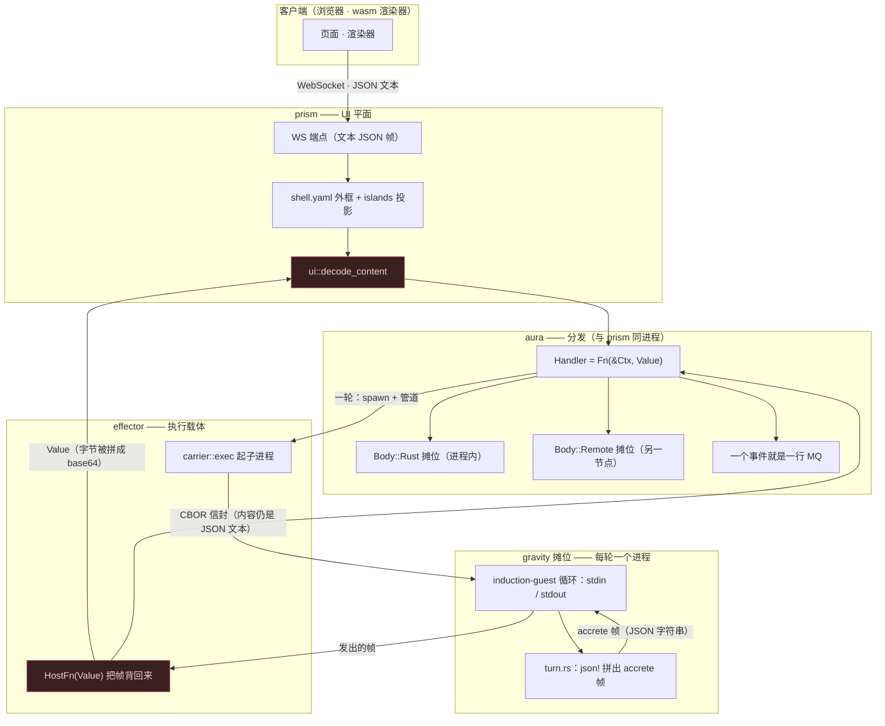
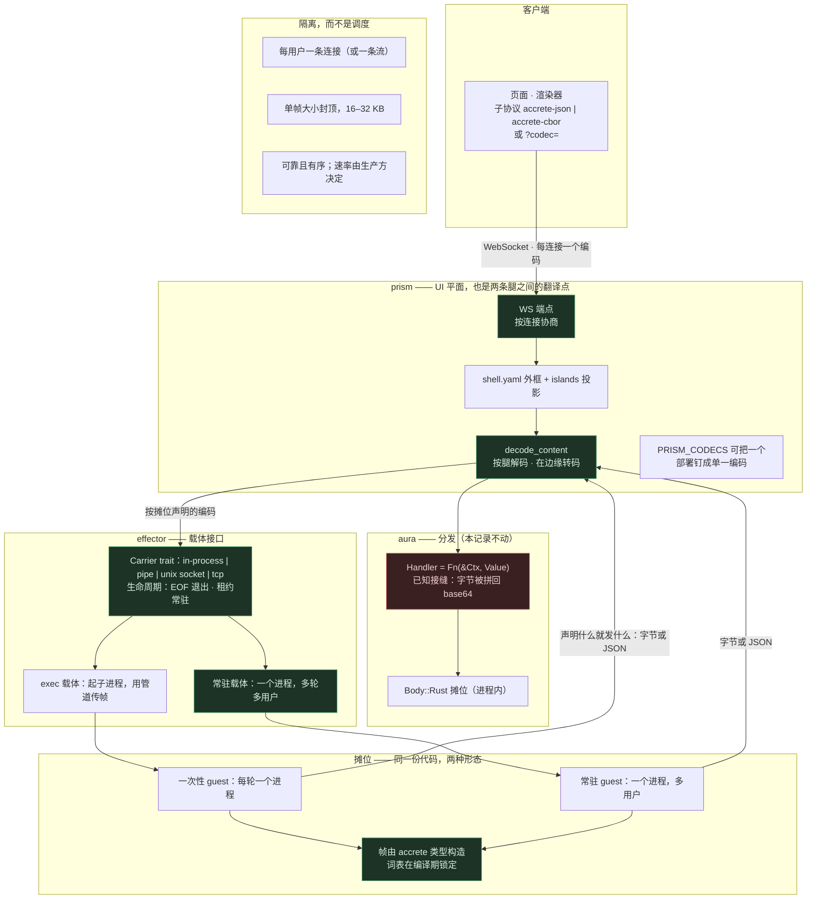

# 0004 — 载体是一个接口：管道、套接字与常驻摊位

> **语言：** [English](0004-the-carrier-is-an-interface.md)（主） · [中文](0004-the-carrier-is-an-interface.zh-CN.md)

**状态：** 提议（2026-11-19）。本记录中的一切尚未实现；它陈述的是执行模型在承担更多东西之前应当成为的形状。
**日期：** 2026-11-19

## 背景

摊位由 `Body` 标识：`Rust`（编译进宿主的处理器）、`Remote`（同一份东西，在另一个节点上）、`Script`（一个 guest 进程）。`Script` 由 effector 的载体执行，而"载体"今天只意味着一种东西：起一个子进程，用 induction 的帧与它的 stdin / stdout 对话。

这个选择在很多地方承重，却从没被写下来。guest 得知何时停止，是因为父进程关掉了 stdin —— 于是**进程的生命周期就是管道的生命周期**。因此摊位无法活得比一轮更久，无法服务两个用户，也无法用别的方式启动。所有部署问题（"怎么让 gravity 服务所有人"）都归约为"换掉载体"，而载体没有可供替换的接缝。

两个代价现在是具体的，而不是假设的。其一，**模型里没有常驻摊位的位置**：让 gravity 服务一个安装的全部用户，需要一个进程多路复用多轮，而当前的生命周期规则直接禁止此事。其二，**载荷类型在每一跳都是 `serde_json::Value`**（`HostFn`、`Realm::emit`、`aura_booth::Handler`），CBOR 字节串过不去，只能被重新拼成 base64 —— 实测 4568 B 的 CBOR 在那个接缝变成 6168 B，与紧凑 JSON（6182 B）相比没有优势。

## 现在的形状

这张图里有三条性质是本记录的主题，而它们都不是哪个 crate 的 bug：

1. **生命周期是管道的意外产物。** stdin 的 EOF 是 guest 结束的原因，所以"每轮一个进程"不是策略，而是唯一可能的行为。
2. **载体是一个写死的决定，不是一个接口。** `exec` 是唯一的实现，于是任何部署形态都必须被表述为"起一个子进程"。
3. **载荷类型在 realm 接缝处擦除成 `Value`。** 二进制死在那里，生产方知道的所有类型也一并死掉。

## 决定（提议）

**裁断 —— 载体成为一个有四种实现的接口，生命周期属于载体而非管道。**

1. **一个 trait，四种载体。** `in-process`（处理器）、`pipe`（子进程，即今天的 `exec`）、`unix socket`、`tcp`（以后是 QUIC）。摊位提供帧，载体提供传输，其上没有任何一层需要知道用的是哪一种。

2. **生命周期是载体自己陈述的规则。** `pipe` 随 EOF 结束（父进程关闭就是信号，与今天一致）。`socket` 随租约结束，租约需要续期 —— 常驻摊位因此能服务多轮、多用户，同时在宿主不再应答时仍可被回收。这两条规则都不写进 guest 的循环：guest 从**帧**里学到"停"，而不是从关闭的描述符。

3. **常驻摊位服务多用户；隔离按用户，而不是按进程。** 每个用户一条自己的连接（或一条自己的流），所以慢消费者只堵住自己。这正是共享进程可以是安全的理由：需要隔离的原因在连接层，而连接本来就是分开的。

4. **协议不携带任何丢弃策略。** 帧可靠、按序送达；没有合并、没有优先级、没有"哪些操作可丢"的规则、没有队列状态机。唯一保留的是一条几何约束：单帧大小封顶 —— 因为无上界的帧会让它自己那条连接阻塞整整一个发送时长。发出频率由生产方决定，传输层不替它做判断。

5. **载荷类型属于接口的一部分。** 一个能不重新拼写就搬运字节的载体，才是这条改造的要义；`Value` 型边界（`Handler`、`Realm::emit`）暂时保留，并作为已知接缝记录下来，而不是用 `$cbor` 悄悄绕过去。

## 提议的形状

真正的差别不在于方块的数量，而在于**那条写着"一轮：spawn + 管道"的箭头变成了指向一个 trait 的箭头** —— 于是所有过去由管道派生的东西（每轮一进程、不可共享、没有别的传输方式）不再由任何东西派生。

## 后果

- **摊位的部署形态变成被选择的，而不是被暗示的。** 同一个 gravity 构建，既可作为每轮子进程运行（如今天），也可作为常驻服务运行；摊位代码不变，因为它本来就不拥有自己的生命周期。
- **guest 的停止信号必须变成一帧。** 今天是关闭的描述符。在租约载体下没有描述符可关，所以协议需要一个能携带的"停" —— 代价很小，但这是协议改动，必须在常驻载体出现之前完成，而不是之后。
- **每用户连接成为隔离机制，于是任何设计都不得假设共享一条流。** 把所有用户排到一条连接上的设计，无法靠后来的调度补救，只能不发生。
- **`Value` 接缝现在带着一个数字被写下来**（4568 B 的 CBOR 在 realm 接缝到达时是 6168 B 的 base64-in-JSON）。它会一直存在，直到分发载荷类型改变；那项改动不属于本记录，也不会因为推迟而变小。
- **常驻摊位把状态变成一个设计问题。** 每轮一进程时可以把任何东西留在内存里，因为它会死；常驻则不能。所以想服务多用户的摊位必须说明：哪些状态按轮、哪些按用户、哪些共享 —— 这是摊位层面的决定，本记录无法替它做。

## 相关记录

effector ADR-0002（摊位是一个 body）、ADR-0003（环境模型）、gravity ADR-0013（编码是传输轴 —— 按腿协商）、gravity ADR-0007（模型配置）、induction 的帧协议。